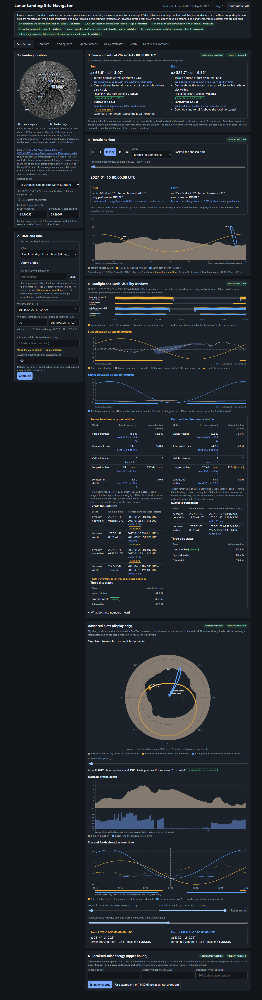

# Lunar Landing Site Navigator

**NASA International Space Apps Challenge 2026.** A scientifically grounded tool for comparing lunar south-pole landing sites and dates by **terrain-corrected Sun and Earth visibility**: when is the Sun above the local terrain horizon, when can Earth be seen (for direct-to-Earth communication geometry), how long are the longest periods without either, and how much does the answer move if the landing position is uncertain?

> Independent project, **not a NASA product and not endorsed by NASA, JPL or ASU.** All scientific data are public NASA data, credited in [docs/ATTRIBUTION.md](docs/ATTRIBUTION.md) and in the application.



## What it does (and deliberately does not)

| It does | It does not |
|---|---|
| Computes Sun and Earth azimuth/elevation for any point near the south pole from NASA/JPL SPICE (DE440), light-time and stellar-aberration corrected | Model communication link budgets, irradiance, thermal or battery behaviour. **Geometric line of sight / direct illumination only** |
| Builds the terrain horizon from LOLA elevation models by ray sampling on the 1737.4 km sphere (curvature included) and combines it with the ephemeris into visibility intervals, fractions and longest outages | Invent terrain. A site without supporting terrain data is reported as **`terrain data insufficient`**, never estimated or ranked |
| Shows **geometric and terrain-corrected** results side by side, every banded number with its **position-uncertainty band** (default ±100 m), and flags intervals cut off by the window edge | Present a band as an error bar: it is a sensitivity to the *input position*, a sample of displacements, not a proven bound |
| Compares sites and dates, simulates mission delays, sweeps parameters, and gives an idealised solar-energy **upper bound** | Claim more than it has: every capability carries an honest status (`validated` = reviewed and approved by the owner, **not** proven against measurement) |

Coverage today: **IM-2 Athena** (20 m terrain to 80 km) is fully supported; **Chandrayaan-3** (60 m terrain) is supported with a visible "terrain not yet approved" flag; **IM-1** has too little terrain data and is labelled as such. See [known limitations](docs/stage9/KNOWN_LIMITATIONS.md) (38 items with their effect).

## Quick start

Requirements: Python 3.12, Node 22+ (for the web UI), ~300 MB of scientific data (not in git).

```powershell
python -m venv .venv ; .\.venv\Scripts\python.exe -m pip install -e ".[dev]"
.\.venv\Scripts\python.exe scripts\provision_data.py --warm      # NAIF kernels + LOLA windows from NASA (30-60 min first time; resumable)
.\.venv\Scripts\python.exe -m uvicorn lunarnav_api.main:app --port 8000      # API (development)
cd web ; npm ci ; npm run dev                                                # UI at http://localhost:5173
```

One-process **production** mode (UI + API on one port) and Docker: see [docs/DEPLOYMENT.md](docs/DEPLOYMENT.md). Development details: [docs/DEV_SETUP.md](docs/DEV_SETUP.md).

## Using it (the complete workflow)

1. **Site & time** — pick a landing site on the NASA imagery map (or click anywhere to set coordinates, or type them), choose a window and an optional mission profile, press **Compute**: Sun/Earth positions with a **countdown to sunset and Earthset** (to the next time the body is hidden by terrain, with its band), terrain horizon, sunlight/Earth-contact timelines with bands, advanced plots, a solar-energy upper bound.
2. **Compare** and **Landing sites** — scenarios and sites side by side; insufficient sites are labelled, never ranked.
3. **Explore sweeps** — vary one parameter (start date, window length, position uncertainty, observer height, sampling step).
4. **Delay simulator** — how a launch delay changes the result, with the position band carried into every difference.
5. **Learn** and **Data & assumptions** — plain-language guide; every dataset, checksum, assumption and credit.

A scripted walk-through with the exact numbers to expect is in [docs/stage11/DEMO_SCRIPT.md](docs/stage11/DEMO_SCRIPT.md).

## Verification at a glance

| Evidence | Result |
|---|---|
| Backend tests (engine, API, golden regression, edge cases, hardening) | 388 pass |
| Frontend tests (including accessibility and a "no calculation in the browser" request-count suite) | 186 pass |
| End-to-end, real browser, production build, 26 checks incl. console/network monitoring | 26 / 26 pass ([report](docs/stage11/E2E_REPORT.md)) |
| Ephemeris vs JPL Horizons, 220-row grid | Sun 1.4×10⁻⁸°, Earth 6×10⁻⁷° (criterion 0.01°) |
| Horizon vs an independent implementation | 1.1×10⁻⁹° (criterion 10⁻³°) |
| Security review, dependency audits | [SECURITY_REVIEW.md](docs/stage11/SECURITY_REVIEW.md); `pip-audit` and `npm audit` report no known vulnerabilities |

Full test and validation report: [docs/TEST_AND_VALIDATION.md](docs/TEST_AND_VALIDATION.md).

## Documentation map

| Topic | Where |
|---|---|
| Architecture and boundaries | [docs/ARCHITECTURE.md](docs/ARCHITECTURE.md) |
| Scientific methodology | [docs/METHODOLOGY.md](docs/METHODOLOGY.md) (details per stage under `docs/stage3`–`stage8`) |
| API reference | [docs/API_CONTRACT.md](docs/API_CONTRACT.md) · [docs/openapi.json](docs/openapi.json) · live at `/api/docs` |
| Data provenance and attribution | [docs/ATTRIBUTION.md](docs/ATTRIBUTION.md) · [docs/stage9/PROVENANCE.md](docs/stage9/PROVENANCE.md) |
| Deployment | [docs/DEPLOYMENT.md](docs/DEPLOYMENT.md) |
| Decisions, limitations, future work | [docs/DECISIONS.md](docs/DECISIONS.md) · [KNOWN_LIMITATIONS](docs/stage9/KNOWN_LIMITATIONS.md) · [FUTURE_WORK](docs/stage11/FUTURE_WORK.md) |
| Presentation | [docs/stage11/presentation/Lunar_Landing_Site_Navigator.pptx](docs/stage11/presentation/Lunar_Landing_Site_Navigator.pptx) (14 slides with speaker notes; 11 for the pitch, 3 backup) |
| Stage evidence | `docs/stage0` … `docs/stage11`, `docs/stage10x` (extras), `docs/basemap` (imagery alignment) |

## Licence

No licence has been declared yet; choosing one is a decision for the project owner. Third-party software licences are listed in [docs/ATTRIBUTION.md](docs/ATTRIBUTION.md).
